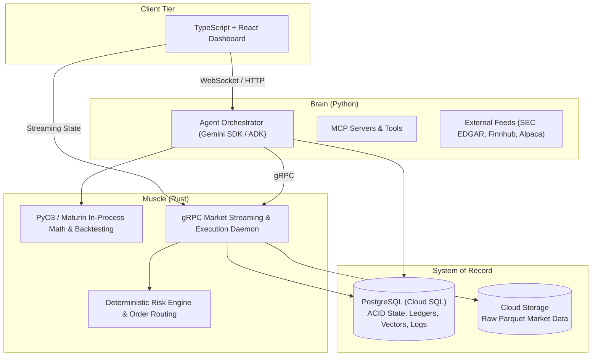

# The Monroe Fund

The Monroe Fund is a polyglot, performance-tiered, cloud-native agentic trading platform designed for high-frequency financial data processing, autonomous multi-agent reasoning, deterministic execution, and robust backtesting.

---

## Architecture Overview

The system decouples intelligence from execution, leveraging distinct languages and runtimes tailored to their specific performance and ecosystem strengths:



---

## Technology Stack

| Layer | Technology | Primary Role |
| :--- | :--- | :--- |
| **Frontend** | TypeScript + React | Structural type-safety across boundaries; real-time market visualization and streaming AI reasoning without UI thread blocking. |
| **Brain (AI / Orchestration)** | Python (Gemini SDK / ADK) | Agent orchestration, MCP servers, SEC.gov/EDGAR parsing, Finnhub market data retrieval, Alpaca integrations. |
| **Muscle (Compute & Execution)** | Rust | High-throughput backtesting, heavy quantitative math, WebSocket streams, deterministic risk checks, and live order routing. |
| **System of Record** | PostgreSQL (Cloud SQL) | Authoritative source of truth: transactional consistency (ACID), user accounts, order ledgers, agent audit trails, and vector embeddings. |
| **Market Data Lake** | Google Cloud Storage | Scalable, cost-effective storage for historical and raw tick/bar market data in Apache Parquet format. |
| **Cloud Fabric** | Google Cloud Platform (GCP) | Cloud Run (services & jobs), Cloud SQL, Secret Manager, Cloud Build, and Cloud CDN. |

---

## Two-Part Hybrid Architecture

The execution layer uses a dual-interface model to maximize performance and ergonomics:
1. **In-Process Compute (PyO3 + Maturin):** Heavy mathematical algorithms, backtesting engines, and quantitative simulations compile directly to native Python extensions, eliminating IPC overhead while bypassing the Python GIL.
2. **Out-of-Process Execution Daemon (gRPC):** An independent, long-running Rust daemon manages persistent exchange WebSockets, market data normalization, live risk checks, and direct order routing.

---

## Environment Configuration

The Monroe Fund requires API credentials for market data feeds, LLM reasoning, and broker execution.

1. **Create your local `.env` file:**
   ```bash
   cp .env.example .env
   ```
2. **Configure your keys in `.env`:**
   * **`GEMINI_API_KEY`**: Required for agent reasoning and vector embedding models ([Google AI Studio](https://aistudio.google.com/)).
   * **`SEC_USER_AGENT`**: Declared User-Agent for SEC EDGAR API compliance (`TheMonroeFund your_email@example.com`).
   * **`FINNHUB_API_KEY`**: Market fundamentals and economic news sentiment ([Finnhub](https://finnhub.io/)).
   * **`ALPACA_API_KEY_ID` & `ALPACA_API_SECRET_KEY`**: Paper/live execution and streaming quotes ([Alpaca Markets](https://alpaca.markets/)).
   * **`DATABASE_URL`**: PostgreSQL connection string for ledger and audit state.

---

## Frontend (React + TypeScript)

The web client lives in [`frontend/`](frontend/) (Vite, React 18, TypeScript, CSS Modules, Recharts, lucide-react). It currently runs on typed mock data behind [`frontend/src/data/api.ts`](frontend/src/data/api.ts).

```bash
cd frontend
npm install
npm run dev      # http://localhost:5173
npm run build    # type-check + production build to frontend/dist
```

Pages: Dashboard, Trades, Risk limits, Accounts, Research (SEC filings). Light/dark theme follows the OS and can be toggled from the top bar.

---

## Project Documentation

* **[AGENTS.md](AGENTS.md)**: Operating protocol and index for AI agents and human contributors.
* **[docs/ARCHITECTURE.md](docs/ARCHITECTURE.md)**: Detailed technical specifications, component contracts, and deployment topologies.
* **[docs/decisions/](docs/decisions/)**: Architecture Decision Records (ADRs).
* **[docs/notes/](docs/notes/)**: Session logs and handoff records.

---

## Contributors

* Marlon
* Fabricio
* Misael
