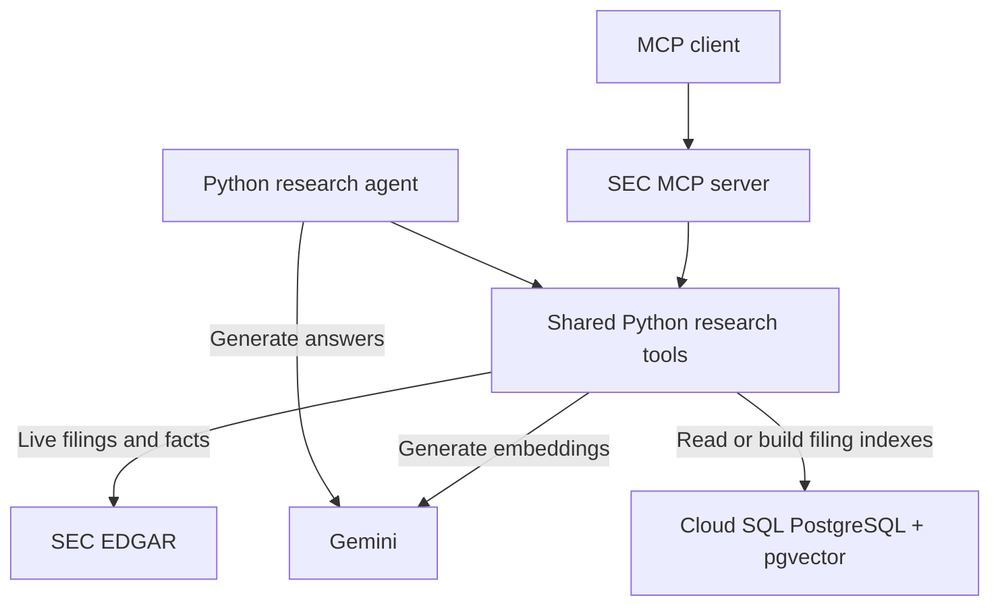

# The Monroe Fund

The Monroe Fund is a Python-first financial research project. Its Gemini agent uses shared research tools to search live SEC EDGAR data and answer questions with filing evidence. MCP exposes those same tools to compatible clients.

---

## Architecture Overview

The agent and MCP tools resolve current filings and fetch financial facts from SEC EDGAR. Cloud SQL for PostgreSQL stores filing excerpts and pgvector embeddings for reuse. When a filing index is missing, a writer-enabled backend fetches the filing from EDGAR and builds the index.



[Detailed architecture](docs/ARCHITECTURE.md#1-near-term-scope) · [PostgreSQL setup](docs/POSTGRESQL.md)

| Area | Current focus / direction |
| :--- | :--- |
| **Python brain** | Agent workflows, financial search and aggregation, SEC filings, retrieval, and AI-generated research. |
| **MCP** | Expose financial data and research tools to agents through MCP. |
| **Data sources** | SEC EDGAR, Massive (daily prices and company details), and Finnhub (quotes, news, metrics, and earnings dates). Alpaca is a potential integration. |
| **Storage** | Cloud SQL filing retrieval is live and verified. A standalone importer can also store selected SEC data. |

The portfolio backend can read Alpaca positions, evaluate deterministic risk limits, and replay a strategy over Massive daily bars. [Portfolio and replay setup](docs/LOCAL_SETUP.md#portfolio-and-strategy-tools)

The final frontend will follow the backend. Rust compute and live execution are deferred. [Python-first scope decision](docs/decisions/0002-python-first-research-scope.md)

---

## Environment Configuration

Start with the [local setup and database testing guide](docs/LOCAL_SETUP.md) for dependencies, credentials, the Cloud SQL proxy, and a 10-Q smoke test.

The Python backend uses Google Cloud Application Default Credentials (ADC) for Gemini and a libpq password file for local Cloud SQL access.

1. **Create your local `.env` file:**
   ```bash
   cp .env.example .env
   ```
2. **Configure your keys in `.env`:**
   * **`GOOGLE_CLOUD_PROJECT`**: Your Google Cloud project ID for agent reasoning and vector embeddings. Set **`GOOGLE_CLOUD_LOCATION=global`** and **`GOOGLE_GENAI_USE_ENTERPRISE=True`** as shown in `.env.example`.
   * **`SEC_USER_AGENT`**: Declared User-Agent for SEC EDGAR API compliance (`TheMonroeFund your_email@example.com`).
   * **`SEC_RAG_READ_DSN` & `SEC_RAG_WRITE_DSN`**: Scoped PostgreSQL connections for [persistent filing retrieval](docs/POSTGRESQL.md#enable-persistent-filing-retrieval). The standalone importer uses standard libpq settings.
3. **Set up Google Cloud ADC:** Enable the Vertex AI API and grant your identity access to use it. For local development, run `gcloud auth application-default login`. On Google Cloud, attach a service account with the necessary permissions. The `.env` values select the project and location; they are not credentials. Run `python python-brain/init.py` to check the setup.

With the Cloud SQL Auth Proxy running and the reader configured, check SEC EDGAR, Gemini, and PostgreSQL together from the repository root. Replace `TICKER` with an SEC-listed ticker. A new filing index requires the writer connection.

```bash
python python-brain/init.py --postgres TICKER
```

---

## Research Security and Data Handling

SEC filings, search results, financial facts, and tool errors are untrusted input. The agent is instructed not to obey instructions embedded in them; MCP research results use a `source`, `trust`, and `data` envelope, and the filing resource returns the same envelope as JSON. MCP clients that consumed the earlier response shapes must read the `data` field. Marking data reduces ambiguity but does not guarantee prompt-injection resistance.

The two filing research tools may insert a derived index when a PostgreSQL writer is configured. The other MCP tools are annotated read-only. Database grants control access. Research tools send requests and query parameters to SEC services, and filing retrieval sends filing chunks and questions to Google's embedding service. Agent prompts, tool results, and conversation content are sent to the configured Google model service. Avoid entering secrets or sensitive personal information until suitable privacy and access controls are in place. Agent tool results are cached for the chat lifetime.

HTTP/SSE binds to `127.0.0.1` by default. The server does not implement application authentication or per-user authorization; before remote or multi-user deployment, add and verify authentication, authorization, TLS, network restrictions, rate limits, and appropriate service-account permissions. Do not rely on localhost binding or MCP tool annotations as a complete security boundary.

---

## Project Documentation

* **[AGENTS.md](AGENTS.md)**: Operating protocol, Google Cloud Well-Architected skills, and index for AI agents and human contributors.
* **[docs/ARCHITECTURE.md](docs/ARCHITECTURE.md)**: Detailed technical specifications, component contracts, and deployment topologies.
* **[docs/decisions/](docs/decisions/)**: Architecture Decision Records (ADRs).
* **[docs/notes/](docs/notes/)**: Session logs and handoff records.

---

## Contributors

* Marlon
* Fabricio
* Misael
