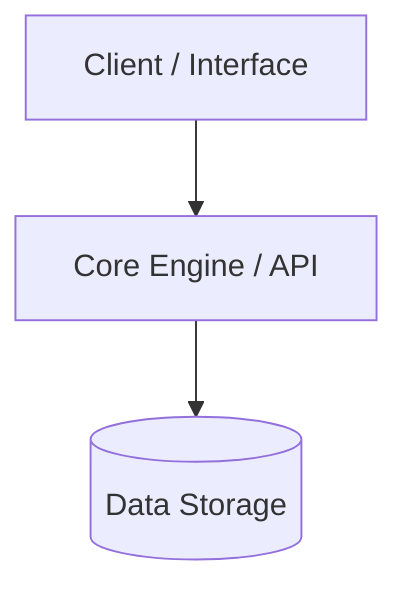

# System Architecture & Technical Specifications

> **Notice:** Project specifications and technical architecture are currently under discussion. This document serves as the canonical reference for the system design once finalized.

---

## 1. High-Level Overview
*A concise summary of what the system does, who uses it, and its primary goals.*

---

## 2. Technology Stack & Dependencies
*Detail the chosen languages, frameworks, runtime environments, and core libraries.*

* **Language / Runtime:** TBD
* **Core Frameworks:** TBD
* **Database / Storage:** TBD
* **Testing Framework:** TBD

---

## 3. System Architecture & Component Diagram
*Describe the major components, services, and communication protocols.*

---

## 4. Key Design Principles & Conventions
*Coding standards, naming conventions, directory structure rules, and project-specific invariants.*

---

## 5. Development & Environment Setup
*Exact instructions for setting up the environment, installing dependencies, and running local builds/tests.*
