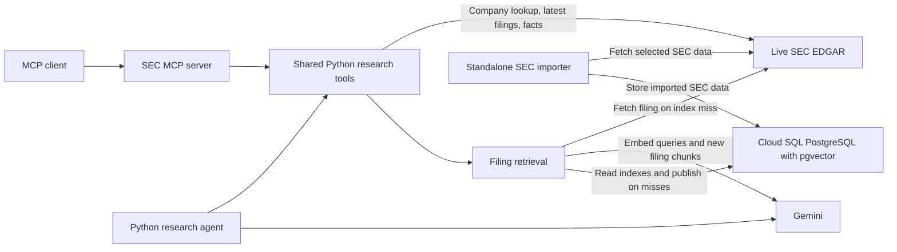

# The Monroe Fund — Architecture & Technical Direction

The Monroe Fund prioritizes Python-based agentic financial research: searching and aggregating financial data, exposing tools through MCP, and producing grounded AI-assisted analysis. This document describes the direction and distinguishes existing capabilities from planned work.

---

## 1. Near-Term Scope

* **Python brain:** The Gemini agent calls Python research tools for company lookup, filing search, retrieval, and synthesis. The MCP server exposes the shared tools to MCP clients.
* **MCP:** Maintain and test the SEC MCP server and its research tools, including both supported transports. Expand tools and sources as research needs warrant.
* **Financial data aggregation:** Combine structured financial facts, unstructured filings, and Massive and Finnhub market data, with further sources such as Alpaca to be evaluated as needed. Attribute findings to their sources and validate data quality.
* **Research tools:** The agent decides the sequence. Typed tools read consolidated XBRL facts and reported dimensions or relationships. EFTS finds filings by keyword. RAG retrieves narrative evidence from a filing. Market data tools supply quotes and other market observations. Each tool handles its own data access and any fallback. The filing timeline lists documents by form and filing date. Figure lookup reads Form 4 transactions and compares institutional Form 13F holdings with citations to the original filings. Linked filing headings support deterministic section excerpts and annual risk-factor comparisons. See [PostgreSQL research setup](POSTGRESQL.md#read-consolidated-facts-and-relationships).
* **Research interface:** The Python agent, MCP server, and authenticated FastAPI application are the current entry points. The HTTP API uses ADK specialists with durable sessions. The final frontend will follow the backend. [Phase 5 contract](decisions/0005-phase-5-api-and-agent-runtime.md)
* **Storage and deployment:** The project Cloud SQL database has pgvector and the filing retrieval tables. Live verification covered building a new index and reusing it with reader-only credentials. The standalone importer can store selected facts and auditor data. Financial-fact tools still query EDGAR live. [PostgreSQL decision](decisions/0003-postgresql-sec-research.md) · [Cloud SQL verification](notes/2026-11-17-cloud-sql-filing-retrieval.md)

Filing retrieval uses an in-memory index when both PostgreSQL connections are unset. A configured reader can query existing indexes, and a separate scoped writer can publish indexes on cache misses. [PostgreSQL setup](POSTGRESQL.md#enable-persistent-filing-retrieval)

### Portfolio and strategy

Alpaca provides account, position, and order data. The separate portfolio schema defines storage for accounts, positions, fills, and risk limits. Pure Python functions evaluate risk. Strategies are data, and the backtester replays them over stored daily bars. A dedicated proposal session can read portfolio exposures and check proposed target weights. Deterministic order sizing stays outside the agent tool surface. The authenticated API and local CLI can opt in to a user-authorized Alpaca paper order per durable decision; proposal-only analysis and agent paper execution are separate API operations. Both order paths use the same database-backed controls and never enable live execution. The React frontend also renders SEC statement visuals and supports configurable local strategy drafts and saved-snapshot replay. PostgreSQL records the intent before submission and reconciles subsequent fills. The same database supplies execution limits and historical peak equity. [Portfolio and strategy decision](decisions/0004-portfolio-and-deterministic-strategy.md)

## 2. Deferred Work

Rust compute, advanced backtesting, streaming, and live order execution are deferred. Revisit them if measured workloads or product requirements justify the additional components. [Original architecture](decisions/0001-polyglot-trading-platform-architecture.md) · [Python-first scope decision](decisions/0002-python-first-research-scope.md)

## 3. Development Considerations

Prioritize source attribution, input validation, reliable error handling, and evaluation against real filings. Measure model and embedding cost, retrieval quality, and service performance before adding infrastructure or optimizing. Protect credentials and avoid logging sensitive data. Existing live verification and integration tasks are tracked in [AGENTS.md](../AGENTS.md#active-tasks--backlog).

---

## 6. Well-Architected Development Guidance

The [Google Cloud Well-Architected Framework](https://docs.cloud.google.com/architecture/framework) guides the design, implementation, and operation of this platform. These are design objectives, not claims that the proposed infrastructure or controls already exist. Apply the relevant [project skills](../AGENTS.md#google-cloud-well-architected-framework) to each meaningful change, balancing the pillars against the research system's security, reliability, and cost requirements.

* **Operational excellence:** Automate repeatable builds and deployments; define observable service health, actionable alerts, and recovery procedures. Avoid logging secrets or unnecessary sensitive data.
* **Security, privacy, and compliance:** Limit access to each service and role, protect credentials and research data in transit and at rest, and validate tool inputs and external data. Define audit and retention policies before a shared deployment.
* **Reliability:** Define availability and recovery objectives for each service. Test backups, restoration, reconnects, and failure handling for SEC calls, model requests, and database writes.
* **Cost optimization:** Measure model, embedding, storage, database, and compute usage; right-size resources and set budgets appropriate to the workload. Evaluate savings against reliability and latency needs.
* **Performance optimization:** Set and measure latency, throughput, and capacity targets under representative workloads. Profile bottlenecks, including model and network calls, before optimizing.
* **Sustainability:** Reduce unnecessary computation, model calls, data transfer, and storage; consider regional carbon impact alongside latency, resilience, and data requirements.

For significant changes, record decisions, assumptions, trade-offs, and verification in an ADR or worklog. Establish service-level objectives, recovery targets, and security controls as the relevant services are built and validated.
