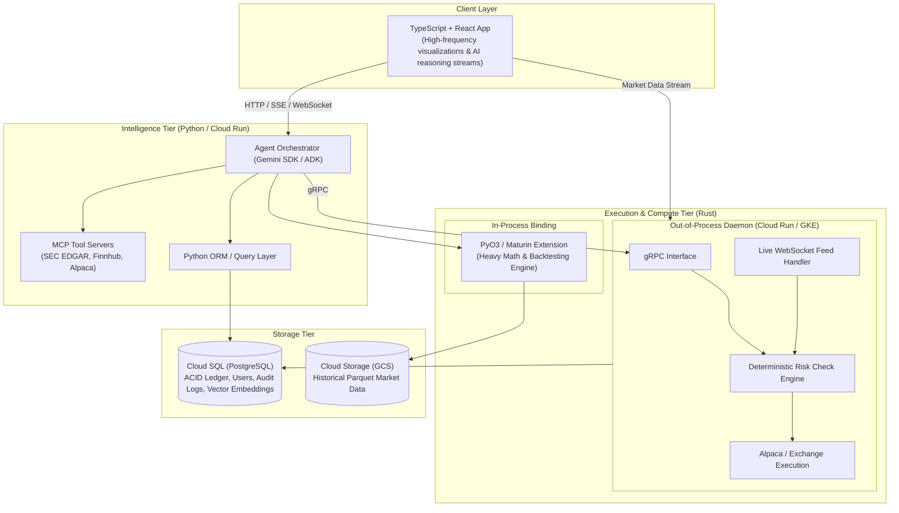
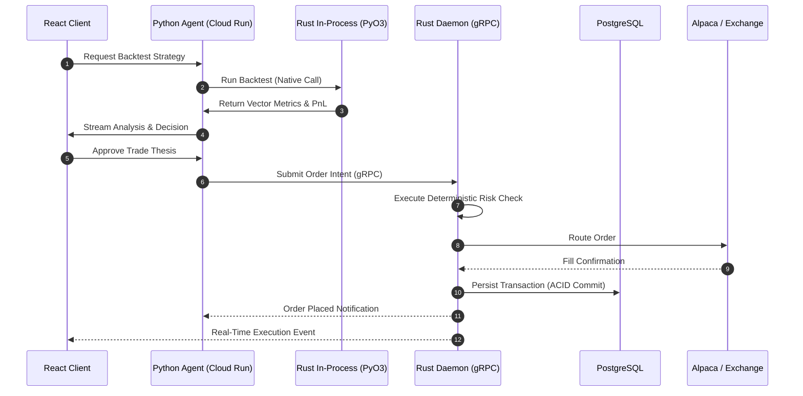

# The Monroe Fund — System Architecture & Technical Specifications

This document defines the architectural blueprints, technology selections, data boundaries, and operational invariants for **The Monroe Fund**, a polyglot, performance-tiered, cloud-native agentic trading platform.

---

## 1. High-Level Overview & Core Philosophy

The Monroe Fund decouples autonomous reasoning from real-time execution:
* **The Brain (Cognitive / Orchestration Layer):** Flexible, dynamic, ecosystem-rich Python services responsible for LLM workflows, financial data ingestion, Model Context Protocol (MCP) tool hosting, and trade thesis generation.
* **The Muscle (Execution & Compute Layer):** Memory-safe, zero-cost abstraction, low-latency Rust services responsible for backtesting, numerical math, deterministic risk validation, WebSocket stream ingestion, and broker execution.
* **The System of Record:** PostgreSQL as the single source of truth for transactional state, ledgers, audit logs, and vector storage.
* **The Infrastructure Fabric:** Google Cloud Platform (GCP) for containerized serverless runtimes, job execution, managed databases, and cloud-native object storage.

---

## 2. Technology Stack & Rationale

### 2.1. Frontend: TypeScript + React
* **Structural Type-Safety:** TypeScript enforces compile-time schema contracts across WebSocket and REST/gRPC-Web boundaries, preventing runtime type mismatches in financial state displays.
* **Non-Blocking UI Concurrency:** React's concurrent rendering primitives decouple rapid market data ticks from the visual updates of streaming LLM reasoning traces, preventing browser frame drops or tab freezing.

### 2.2. Intelligence Tier: Python (Gemini SDK / ADK)
* **Agent Ecosystem Dominance:** Python provides premier native support for advanced LLM frameworks, agent orchestration (Gemini SDK, Agent Development Kit / ADK), and Model Context Protocol (MCP) server implementations.
* **Data Integration:** Rapid ingestion and normalization of unstructured financial texts (SEC.gov, SEC EDGAR 10-K/10-Q filings, financial news) and structured market feeds (Finnhub, Alpaca).

### 2.3. Execution & Compute Tier: Rust
* **Zero-Cost Abstractions & Memory Safety:** Eliminates garbage collection pauses and bypasses Python's Global Interpreter Lock (GIL), providing deterministic microsecond latency for execution and order validation.
* **Deterministic Risk Invariants:** Strict ownership and affine type system guarantee that risk limits, balance verifications, and state transitions are mathematically proven at compile time.

### 2.4. System of Record: PostgreSQL (Cloud SQL)
* **Authoritative Transactional Consistency (ACID):** Centralizes user balances, order books, positions, execution fills, and immutable audit logs within transactional boundaries.
* **Multi-Modal Capability:** Serves relational tabular data and high-dimensional vector embeddings (via `pgvector`) in a single consistent datastore, simplifying agent memory persistence.

### 2.5. Market Data Lake: Google Cloud Storage (GCS) + Parquet
* **Analytical Efficiency:** Raw tick-level and bar market data stored in columnar Apache Parquet format. Columnar compression maximizes I/O throughput when reading historical datasets during parallel Rust backtests.

---

## 3. Two-Part Hybrid Architecture (Python-Rust Bridge)

To achieve maximum performance without sacrificing agent flexibility, the Python-to-Rust bridge is divided into two distinct communication paths:

### 3.1. In-Process Compute via PyO3 & Maturin
* **Use Case:** High-throughput numerical calculations, portfolio optimization, historical simulations, and multi-asset backtesting.
* **Mechanics:** Rust code compiles into a native CPython extension module (`.so` / `.pyd`) using `maturin` and `PyO3`. Python agents call Rust quantitative functions directly with zero inter-process network overhead. Memory buffers are shared via zero-copy arrow/numpy representations where applicable.

### 3.2. Out-of-Process Daemon via gRPC
* **Use Case:** Live exchange connectivity, streaming WebSocket feeds, deterministic order validation, and live broker execution.
* **Mechanics:** The execution engine runs as an independent daemon. The Python agent orchestrator sends trade intents over low-latency gRPC (Protocol Buffers). The daemon validates deterministic risk checks against active state and submits orders directly to broker endpoints (e.g., Alpaca API).

---

## 4. Google Cloud Platform (GCP) Deployment Topology

The platform architecture is designed natively for Google Cloud infrastructure:

* **Static Frontend:** React single-page application built as static artifacts, deployed to Google Cloud Storage and distributed globally via Google Cloud CDN with Cloud Armor protection.
* **Serverless Agent Services (Cloud Run):** Python agent orchestrators and MCP servers operate as containerized Cloud Run services, scaling horizontally on incoming requests or event triggers.
* **Compute-Heavy Jobs (Cloud Run Jobs):** Parallelized, large-scale Rust backtesting simulations run as ephemeral Cloud Run Jobs with dedicated CPU/memory allocations.
* **Persistent Daemon (Cloud Run / GKE / Compute Engine):** The Rust execution and WebSocket ingestion daemon runs in an always-on container environment (Cloud Run with min-instances=1 or GKE) to maintain unbroken exchange WebSocket streams.
* **Managed Database (Cloud SQL for PostgreSQL):** Highly available PostgreSQL instance managing transactional tables and vector embeddings.
* **Secrets & Build Pipelines:** Google Cloud Secret Manager manages API keys (SEC, Finnhub, Alpaca, Gemini), while Cloud Build drives polyglot CI/CD pipelines compiling Rust binaries and Docker containers.

---

## 5. Security, State, and Operational Invariants

1. **Deterministic Risk Pre-Checks:** No order generated by an AI agent reaches a broker without passing through Rust's deterministic validation engine (checking margin requirements, portfolio concentration, maximum drawdown, and symbol allowances).
2. **Comprehensive Agent Auditability:** Every prompt, tool invocation, intermediate reasoning state, and resulting execution order is committed to PostgreSQL with a cryptographic timestamp and agent identifier.
3. **Strict Separation of Concerns:** Python agents propose trades; Rust execution engines validate and place trades. The AI layer cannot bypass Rust risk controls.
